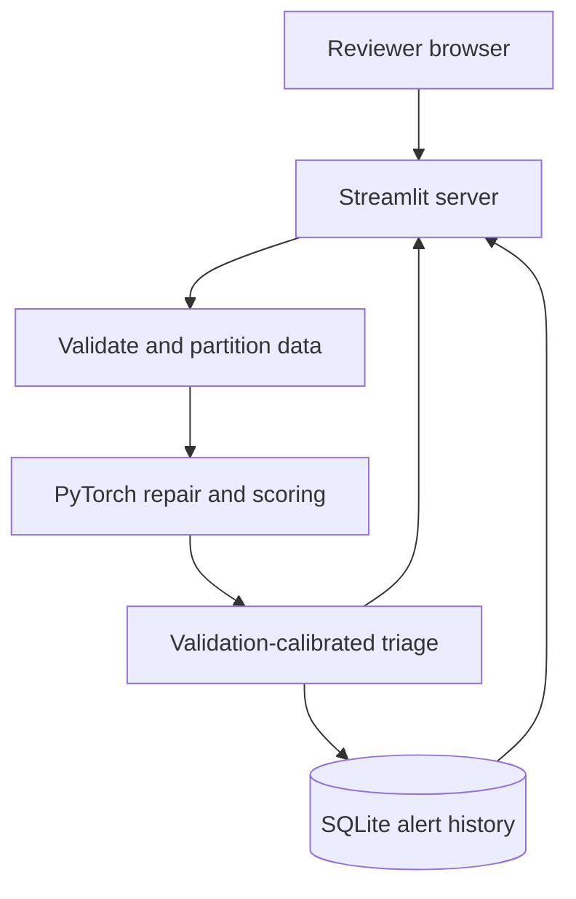

# Deploy ReVive

## Public link for both subjects

The public Streamlit demo runs the model on synthetic transactions. It includes
the verified credit-card benchmark and threshold comparison in a separate
expander. The live results change with the demo task and are labeled separately
from the recorded credit-card experiment.

1. Create or open a GitHub repository for ReVive. Commit this folder's contents
   at the repository root, including `.streamlit/config.toml`.
2. Sign in to [Streamlit Community Cloud](https://share.streamlit.io/) with
   GitHub. Choose **Create app**, then select the repository and its branch.
3. Set the main file path to **streamlit_app.py** and select **Python 3.12**
   under Advanced settings. Deploy and copy the assigned `streamlit.app` URL.
4. Open the link in an incognito window. Click **Train & Score** and check the
   benchmark, alert policy table, explanation, and alert history. Expand
   **Verified credit-card fraud benchmark** to see the recorded real-data run.
5. Use the same URL in the ML and Software Engineering submissions. Cite
   `VERIFICATION.md` for the real credit-card experiment.

GitHub contains source and configuration. The packaged ignore rules exclude
CSV data, SQLite files, and common secret files. On Community Cloud, the SQLite
history belongs to the running app instance and contains synthetic alerts shared
across visitors. The history can reset on redeploy or instance replacement.

## Full application on a server with durable storage

Build and run with Docker on a trusted machine. The named volume is initialized
with ownership from the image and retains SQLite records across container
replacement.

```text
docker build -t revive .
docker volume create revive-alerts
docker run -d --name revive --restart unless-stopped -p 127.0.0.1:8501:8501 -v revive-alerts:/var/lib/revive revive
```

Open `http://127.0.0.1:8501` on the host. The container runs **app.py**, which
also accepts CSV uploads. To share this mode remotely, put it behind an
authenticated HTTPS reverse proxy with WebSocket forwarding, and provide the
reviewers access. Keep the SQLite volume on the host when updating the image.
This mode has one shared alert history for the authorized deployment group.

Check `docker logs revive` for startup errors and check
`http://127.0.0.1:8501/_stcore/health` for service readiness. For a deployment
acceptance check, upload a sample CSV, score it, restart the container, and
confirm the saved alerts still appear.

## Architecture



`streamlit_app.py` runs the public configuration. `app.py` runs the full
configuration. `REVIVE_DB_PATH` controls where SQLite stores the alert history.
Both configurations use the same model, scoring, explainability, and triage
modules.
