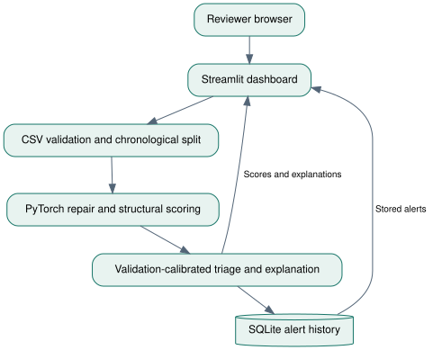

# ReVive

**Explainable financial anomaly detection**
UCS503P Software Engineering · Thapar Institute of Engineering and Technology

ReVive scores chronological windows of financial transactions, ranks unusual windows for review, and shows which features contributed most to the model's repair error.

[Open the live ReVive app](https://revive2627.streamlit.app/) · [Source repository](https://github.com/aakritisharma001/ucs503p-202627-ReVive)

## Try the workflow

1. Choose **Synthetic demo data** or upload a public, labeled transaction CSV.
2. Click **Train & Score** to see the anomaly timeline, benchmark, and alert policy comparison.
3. Open the explanation drill-down for a flagged window. The SQLite history below records the saved alerts.

The hosted app accepts CSV uploads and exposes the model settings. Use public sample data. The hosted SQLite database is shared within the app instance and may reset when the instance is replaced.

## Architecture

The repair model learns from normal training windows. The dashboard compares observed and repaired windows on amplitude, first differences, trend, and cross-channel correlation. It highlights feature-level repair error and calibrates alert thresholds from normal validation windows.

## Held-out results

The experiment used the first **8,000 rows** of the ULB credit-card dataset. The chronological split was **4,320 / 480 / 3,200 rows** for training, validation, and testing. Window size was 50, stride was 5, and training seed was 42.

| Detector | Average precision | ROC-AUC |
|---|---:|---:|
| **ReVive** | **0.9681** | **0.9894** |
| Isolation Forest | 0.3249 | 0.6646 |
| Local Outlier Factor | 0.4914 | 0.8161 |

Among the same 631 test windows, validation calibration cut the flagged count from **626 to 338** and increased precision from **21.57% to 39.94%**, with recall at **100%** in this experiment. The resulting **53.57%** alert rate remains a limitation. These numbers describe overlapping windows on the selected subset.

## Project material

- [Project proposal (PDF)](https://github.com/aakritisharma001/ucs503p-202627-ReVive/blob/master/project-proposal/main.pdf)
- [Prototype report (PDF)](https://github.com/aakritisharma001/ucs503p-202627-ReVive/blob/master/project-report-prototype-stage/main.pdf)
- [Final seminar (PDF)](https://github.com/aakritisharma001/ucs503p-202627-ReVive/blob/master/project-report-final/seminar.pdf)
- [Final report (PDF)](https://github.com/aakritisharma001/ucs503p-202627-ReVive/blob/master/project-report-final/main.pdf)
- [Prototype presentation](https://github.com/aakritisharma001/ucs503p-202627-ReVive/blob/master/project-report-prototype-stage/ReVive-prototype.pdf)
- [Verification results and setup](https://github.com/aakritisharma001/ucs503p-202627-ReVive/blob/master/code/VERIFICATION.md)
- [Team journals](journals/index.md)
