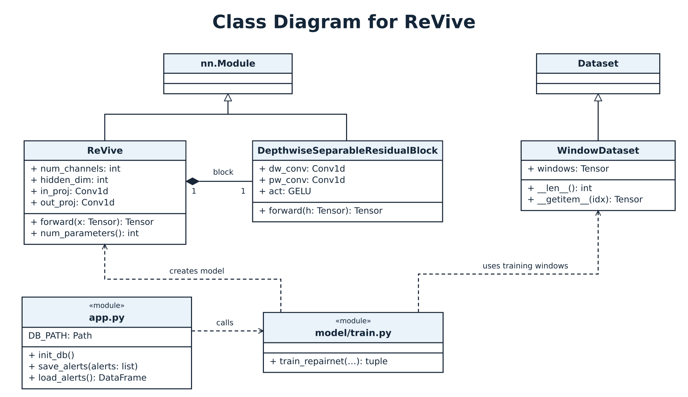
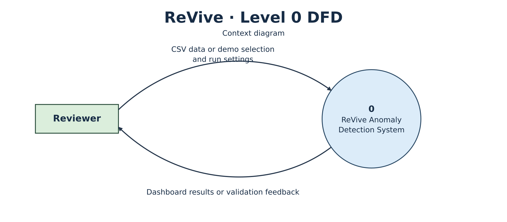
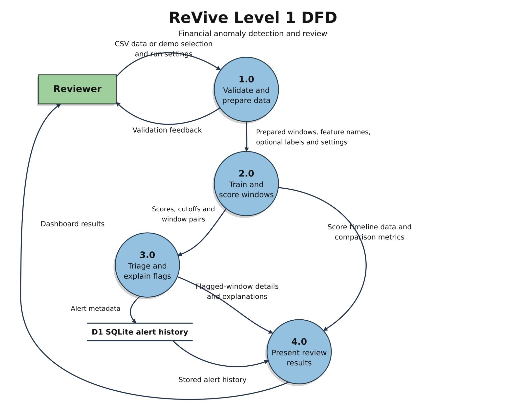
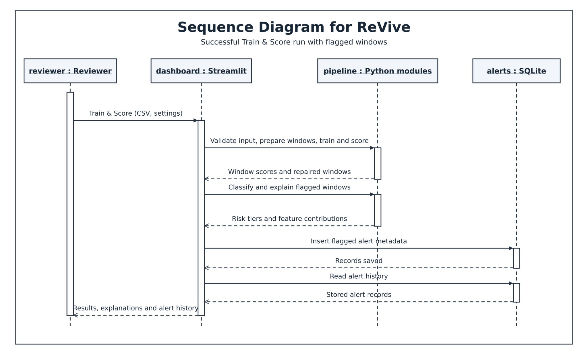

# System design diagrams

These diagrams document the deployed ReVive scoring and review workflow.

## Class diagram

The repair network, residual block, and training dataset show the model structure.

## Level 0 data flow diagram

The context diagram shows the data exchanged between the Reviewer and ReVive.

## Level 1 data flow diagram

The detailed data flow shows preparation, scoring, alert triage, and SQLite history.

## Sequence diagram

The successful scoring path goes from Streamlit through the Python pipeline and SQLite.

